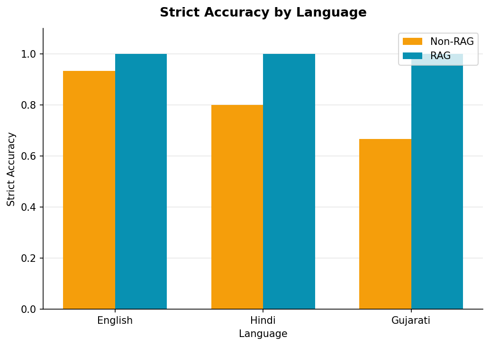
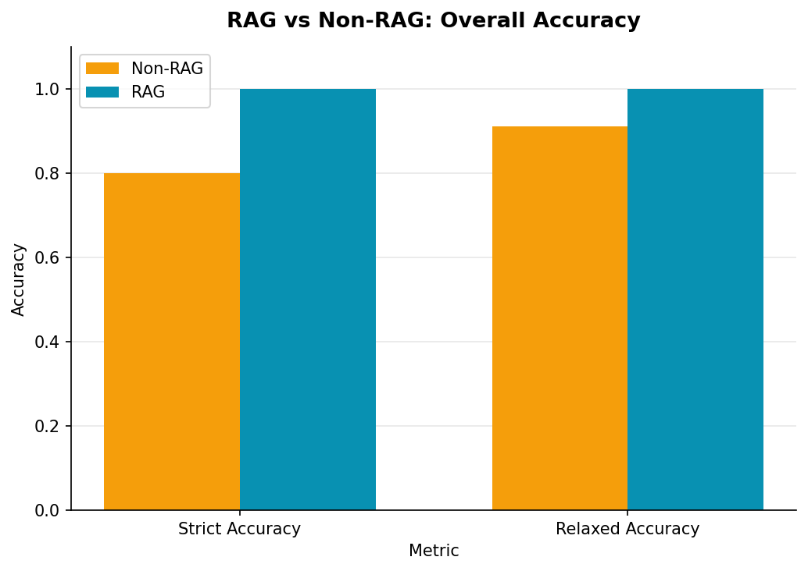

# Multilingual RAG Evaluation & LLM Hallucination Detection System

An interactive system for evaluating retrieval quality, response groundedness, and hallucination risk across **English, Hindi, and Gujarati** — built as an AI reliability dashboard, not a chatbot.


---

## Project Overview

This project evaluates how **Retrieval-Augmented Generation (RAG)** affects an LLM's factual reliability compared to the same model answering from parametric knowledge alone, across three languages with very different levels of representation in most LLM training data.

For every question, the system:
1. Retrieves relevant context from a multilingual knowledge base using FAISS + multilingual embeddings
2. Generates a **Non-RAG** answer (model's own knowledge only)
3. Generates a **RAG** answer (grounded in retrieved context)
4. Splits both answers into individual claims
5. Checks each claim's semantic groundedness against the retrieved context
6. Classifies hallucination risk and compares both answers against a verified reference answer

## Problem Statement

LLMs frequently produce fluent, confident-sounding answers that are subtly or entirely wrong — a failure mode known as **hallucination**. This risk compounds in multilingual settings, where a model's factual reliability in lower-resource languages can differ meaningfully from its reliability in English, even for the same underlying fact. Most public demonstrations of RAG show that it "helps," without measuring *how much*, *where*, or *for which languages* it actually matters.

## Why Hallucination Detection Matters

An LLM that hallucinates confidently is more dangerous than one that hedges — users have no visual signal that anything is wrong. Detecting when a response is untethered from retrieved evidence, and communicating that risk clearly, is a prerequisite for trustworthy LLM deployment in any factual-answering context (search, education, customer support, research assistants).

## Key Methodological Distinction

This project treats two questions as **separate, independently tracked dimensions** — a distinction many RAG evaluation demos collapse into one:

| Dimension | Question it answers | Checked by |
|---|---|---|
| **Factual Correctness** | Does the answer match the verified reference? | Normalized text matching against `reference_answer` |
| **Context Groundedness** | Is the answer traceable to the retrieved documents? | Embedding similarity between claim and context |

A response can be **grounded but wrong** (echoes a real retrieved passage but misstates a detail) or **correct but ungrounded** (right answer, not traceable to what was retrieved) — these are meaningfully different failure modes, and the system never conflates them into a single label.

---

## System Architecture

User Question
↓
Language Selection (English / Hindi / Gujarati)
↓
Multilingual Knowledge Base (54 documents, 3 languages)
↓
Text Embedding (intfloat/multilingual-e5-base)
↓
Vector Search (FAISS IndexFlatIP)
↓
Relevant Context Retrieval (top-k, same-language)
↓
Non-RAG LLM Response + RAG LLM Response
↓
Claim Extraction (sentence-level split)
↓
Context Groundedness Check (embedding similarity heuristic)
↓
Hallucination Risk Classification (Low / Medium / High)
↓
Correctness Check (vs. reference answer) + Final Comparison + Metrics


## Features

- Multilingual factual Q&A across English, Hindi, and Gujarati
- FAISS-based multilingual vector retrieval with a curated 54-document knowledge base (45 matching + 9 distractor documents)
- Side-by-side RAG vs Non-RAG response comparison
- Claim-level hallucination detection with transparent, human-readable reasoning per claim
- Explicit separation of context groundedness from factual correctness
- Full evaluation suite: Strict/Relaxed Accuracy, Hallucination Rate, Groundedness Rate, Retrieval Success Rate
- Interactive Streamlit dashboard (Home / Try the System / Evaluation Dashboard)
- Reproducible experiment pipeline with CSV outputs and 8 professional charts

## Technologies Used

| Component | Technology |
|---|---|
| LLM Inference | Groq API — `openai/gpt-oss-20b` |
| Embeddings | `intfloat/multilingual-e5-base` (Sentence Transformers) |
| Vector Search | FAISS (`IndexFlatIP`, exact cosine similarity via normalized embeddings) |
| Application | Streamlit |
| Data Processing | pandas, numpy |
| Visualization | Matplotlib |
| Notebooks | Jupyter |

## Project Structure

multilingual-rag-evaluation/
├── app.py # Streamlit application (3 pages)
├── data/
│ ├── raw/questions.csv # 45 questions (15 facts x 3 languages)
│ ├── knowledge_base/knowledge_base.csv # 54 documents (45 matching + 9 distractor)
│ ├── processed/ # Cached FAISS index + embeddings
│ └── results/experiment_results.csv # Full 45-question experiment output
├── src/
│ ├── config.py # Centralized paths, constants, thresholds
│ ├── data_loader.py # CSV loading + validation
│ ├── build_seed_data.py # Generates questions.csv + knowledge_base.csv
│ ├── embeddings.py # multilingual-e5-base wrapper
│ ├── retriever.py # FAISS index build/load/query
│ ├── evaluate_retrieval.py # Top-1 retrieval accuracy check
│ ├── prompts.py # RAG / Non-RAG prompt templates
│ ├── llm_client.py # Groq API wrapper (retries, error handling)
│ ├── claim_analyzer.py # Sentence-level claim splitting
│ ├── hallucination_detector.py # Claim-vs-context similarity scoring
│ ├── calibrate_thresholds.py # Empirical threshold calibration
│ ├── evaluator.py # Full experiment runner + all metrics
│ ├── rag_pipeline.py # Interactive single-question pipeline (used by app.py)
│ ├── visualization.py # Generates all 8 charts
│ └── build_notebooks.py # Generates the 3 Jupyter notebooks
├── notebooks/
│ ├── 01_data_exploration.ipynb
│ ├── 02_retrieval_analysis.ipynb
│ └── 03_rag_evaluation.ipynb
├── outputs/
│ ├── charts/ # 8 generated PNG charts
│ └── tables/ # All metric summary CSVs
├── requirements.txt
├── .env.example
├── .gitignore
└── README.md


## RAG Pipeline

1. **Retrieval**: the query is embedded (`query: ` prefix) and compared via FAISS `IndexFlatIP` against 54 passage embeddings (`passage: ` prefix), restricted to same-language documents.
2. **Non-RAG generation**: the LLM answers from its own knowledge, with no retrieved context in the prompt.
3. **RAG generation**: the LLM answers using only the retrieved context, instructed to say so honestly if the context is insufficient rather than guess.
4. **Claim splitting**: each response is split into 1-3 sentence-level claims (both prompt templates constrain output length specifically to make this split reliable).
5. **Groundedness check**: each claim is compared against the retrieved context via embedding cosine similarity and classified as Supported / Partially Supported / Unsupported / Unable to Determine.

## Hallucination Detection Methodology

**This is a semantic similarity heuristic, not automated logical entailment or fact-checking.**

- A claim is embedded and compared against all retrieved context documents using multilingual sentence embeddings.
- The maximum cosine similarity score determines classification:
  - `≥ 0.80` → **Supported**
  - `0.65 – 0.80` → **Partially Supported**
  - `< 0.65` → **Unsupported**
- These thresholds were empirically calibrated (`src/calibrate_thresholds.py`) by measuring real similarity scores across 45 RAG-generated claims checked against their own retrieved context — genuinely grounded claims scored between 0.80 and 0.93, confirming the threshold sits close to where real support naturally lands for this embedding model.
- **Important**: a high score means a claim's *wording* is semantically close to a retrieved passage — it does not verify logical entailment. A low score means no close match was found in retrieved context — it does **not** mean the claim is factually false. True NLI/entailment models exist for English but do not reliably support Hindi and Gujarati, so this project uses one consistent method across all three languages rather than silently downgrading accuracy for two of them.

Groundedness score per response = `(Supported + 0.5 × Partially Supported) / Determinate Claims` — the 0.5 weight is a documented design choice, not a fitted statistical parameter.

## RAG vs Non-RAG Comparison — Measured Results

Full experiment across all 45 questions (`src/evaluator.py`):

| Metric | Non-RAG | RAG |
|---|---|---|
| Strict Accuracy | 80.0% | **100.0%** |
| Relaxed Accuracy | 91.1% | **100.0%** |
| Avg. Groundedness Score | 0.994 | 1.000 |
| Retrieval Success Rate | 100.0% | 100.0% |

**Where RAG helped most** (Strict Accuracy, Non-RAG → RAG):
- **Gujarati**: 66.7% → 100.0% — the largest single-language gap, consistent with Gujarati being comparatively under-represented in most LLM pretraining data.
- **History**: 60.0% → 100.0% — the largest single-category gap, plausibly due to specific dates/names being harder to recall precisely without grounding than broad scientific facts.

This is the core finding of the project: **RAG's benefit is not uniform** — it is concentrated exactly where a model's fluency in a language or domain is weakest, which is a more useful and defensible claim than "RAG generally helps."

## Evaluation Metrics

**Response labels** (never conflated): `Correct` · `Partially Correct` · `Incorrect` · `Unsupported-Hallucinated` · `Unable to Evaluate`

- `Incorrect` = doesn't match the reference, but still reasonably grounded in retrieved context (Low/Medium hallucination risk)
- `Unsupported-Hallucinated` = doesn't match the reference **and** not traceable to retrieved context (High risk)

**Accuracy**: Strict (exact/near-exact match) and Relaxed (≥60% significant-word overlap with reference) — both are **lexical heuristics**, not semantic understanding checks.

**RAG metrics**: Context Groundedness Rate, Supported/Unsupported Claim Rate, Retrieval Success Rate (top-1 fact match).

**Hallucination metrics**: Hallucination Rate, Risk Distribution (🟢 Low / 🟡 Medium / 🔴 High).

All breakdowns computed by language and by category — see `outputs/tables/`.

## Streamlit Application

Three pages:
- **🏠 Home** — project overview, pipeline diagram, methodology note
- **💬 Try the System** — ask any question (or pick a dataset example), see retrieved context, both responses side-by-side, and a per-claim inspector with human-readable reasoning
- **📊 Evaluation Dashboard** — all aggregate metrics and charts from the 45-question experiment

## Installation

```bash
git clone <your-repo-url>
cd multilingual-rag-evaluation
python -m venv venv
.\venv\Scripts\Activate.ps1          # Windows PowerShell
pip install -r requirements.txt
```

## Configuration

```bash
copy .env.example .env
```

Edit `.env` and add your [Groq API key](https://console.groq.com):

LLM_PROVIDER=groq
LLM_MODEL=openai/gpt-oss-20b
API_KEY=your_api_key_here


## Running the Project

```bash
# 1. Generate the dataset and knowledge base
python -m src.build_seed_data

# 2. Build the FAISS retrieval index and verify retrieval quality
python -m src.retriever
python -m src.evaluate_retrieval

# 3. Run the full 45-question experiment (RAG + Non-RAG, ~90 API calls)
python -m src.evaluator

# 4. Generate charts
python -m src.visualization

# 5. Generate notebooks (optional)
python -m src.build_notebooks

# 6. Launch the app
streamlit run app.py
```

## Screenshots

> - `docs/screenshots/home.png`
> - `docs/screenshots/try_the_system.png`
> - `docs/screenshots/claim_inspector.png`
> - `docs/screenshots/dashboard.png`

## Results

See `outputs/tables/` for full CSV metric breakdowns and `outputs/charts/` for all 8 generated visualizations, including:




## Limitations

- **Small, clean, well-separated dataset.** 45 questions across 15 topically distinct facts produced 100% retrieval accuracy and uniformly "Low" hallucination risk — this reflects the dataset's deliberate design, not proof the underlying methods are error-free on harder, noisier, or more ambiguous data.
- **Correctness checking is lexical, not semantic.** Normalized text/word-overlap matching will miss some valid paraphrases and is not a substitute for human judgment.
- **Hallucination detection is a similarity heuristic, not entailment.** It measures semantic closeness to retrieved text, not verified logical support — and was calibrated primarily against the "well-supported" end of the score distribution, since this dataset didn't naturally produce many genuinely unsupported claims to calibrate against.
- **Gujarati embedding coverage is comparatively less battle-tested** than English/Hindi in most multilingual models, even though retrieval performed at 100% here.

## Future Improvements

- Expand the dataset with harder, ambiguous, or intentionally conflicting facts to stress-test Medium/High hallucination-risk classification.
- Add an English-specific NLI/entailment model as a secondary signal alongside the similarity heuristic.
- Introduce adversarial or out-of-domain questions to observe retrieval failure modes and their downstream effect on groundedness.
- Expand the knowledge base beyond Geography/History/Science into more categories.


